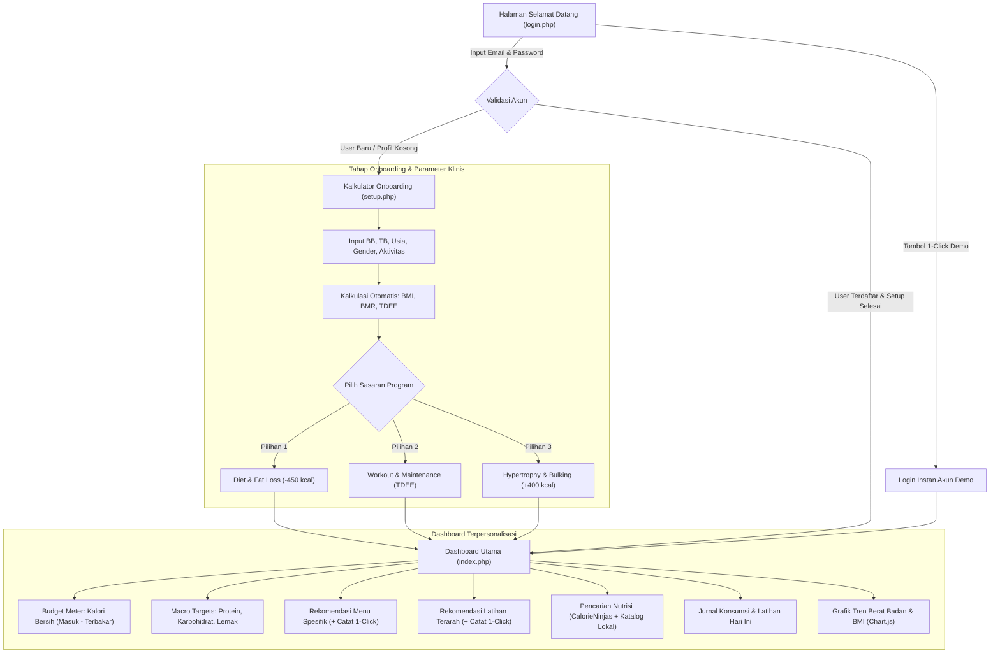
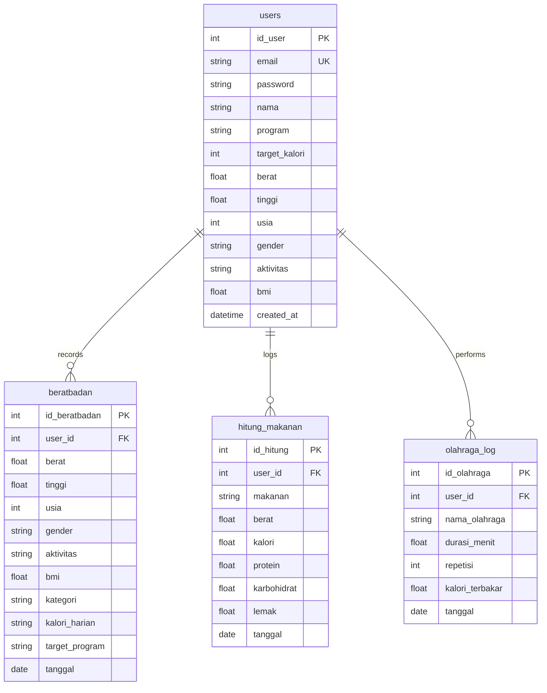

# Product Requirement Document (PRD)
## Let's Move — Modern Calorie & Fitness Management System

---

## 1. Executive Summary & Project Metadata

| Attribute | Details |
|---|---|
| **Product Name** | Let's Move (Calorie & Fitness Tracker) |
| **Project Type** | Fullstack Web Application (Portfolio Showcase / Re-engineering) |
| **Version** | 2.0 (Clean Architecture & Anti-Slop Overhaul) |
| **Author / Lead Engineer** | Fullstack Web Developer / Product Engineer |
| **Status** | Production Ready / Shipped (100% Passed 59 Automated QA Tests) |
| **Repository** | `https://github.com/rzranz/calorie-tracker.git` (`master` branch) |
| **Tech Stack** | PHP 8.3 (Native Service Pattern), PDO Dual-Driver (SQLite Zero-Config + MySQL), Vanilla JavaScript (Modular IIFE), Chart.js, CalorieNinjas API, Custom Modern CSS Design System |

### 1.1 Context & Background
Proyek ini merupakan re-engineering dari sistem pelacak kalori lawas yang sebelumnya membingungkan pemula, memiliki dependensi server yang rapuh (hanya MySQL tanpa fallback), mengalami *bug* pada penyimpanan makanan (*404 missing route & cross-user session leakage*), serta antarmuka yang dipenuhi dekorasi stiker emoji tidak profesional (*AI slop*).

Sistem dibangun ulang secara menyeluruh dengan mengadopsi prinsip **Clean Architecture & Service Pattern**, alur onboarding terarah yang intuitif (*beginner-friendly*), kalkulator klinis **Mifflin-St Jeor**, tiga *tailored program* (Diet, Maintenance, Bulking), database dual-driver otomatis tanpa konfigurasi rumit, serta antarmuka *developer-grade* terinspirasi standar Linear dan Vercel.

---

## 2. Problem Statement & Solution Strategy

### 2.1 The Problem
1. **Curva Belajar Terlalu Curam:** Aplikasi pelacak kalori umum membebani pengguna baru dengan puluhan kolom isian dan navigasi berlapis yang membingungkan.
2. **Kalkulasi Kalori Asal-asalan:** Banyak aplikasi menghitung kalori tanpa memperhitungkan *Basal Metabolic Rate* (BMR) dan tingkat aktivitas nyata (*TDEE*), sehingga target kalori tidak realistis.
3. **One-Size-Fits-All Interface:** Pengguna yang ingin menurunkan lemak (*fat loss*) disajikan dashboard yang sama persis dengan binaragawan yang ingin menambah massa otot (*bulking*).
4. **Dependensi Setup Rumit:** Memerlukan konfigurasi database server manual yang rawan gagal ketika dievaluasi oleh recruiter atau calon klien.
5. **Estetika Rendah (AI Slop):** Desain visual generik yang dijejali stiker emoji kekanak-kanakan, gradien mencolok, dan tata letak tidak seimbang.

### 2.2 Solution Strategy
- **Frictionless Onboarding:** Autentikasi cukup Email & Password dengan fitur **1-Click Demo Login** untuk evaluasi langsung dalam 1 detik.
- **Clinically Accurate Engine:** Kalkulator BMI & BMR menggunakan rumus baku **Mifflin-St Jeor** dikalikan faktor aktivitas harian (TDEE).
- **Goal-Driven Tailored Dashboards:** Tiga dashboard spesifik (Diet, Workout, Bulking) dengan alokasi makronutrisi (Protein, Karbohidrat, Lemak) dan rekomendasi menu/latihan terarah dengan tombol **+ Catat Langsung (1-Click)**.
- **Dual-Database Resilience:** Default SQLite (*zero configuration*) yang langsung dapat dijalankan di terminal mana pun (`php -S localhost:8000`), dengan *fallback* dan dukungan opsional MySQL/MariaDB.
- **Anti-Slop Design Language:** Menghapus seluruh stiker emoji, menerapkan tipografi modern (*Plus Jakarta Sans* dan *JetBrains Mono* untuk data angka), kartu *double-bezel*, dan palet warna OLED gelap berkelas.

---

## 3. User Personas & User Stories

### 3.1 User Personas

#### Persona A: Arya (The Beginner / Weight Loss Aspirant)
- **Profil:** 24 tahun, pekerja kantoran, gaya hidup minim gerak (*sedentary*), berat badan berlebih (BMI 27.5).
- **Goal:** Menurunkan lemak tubuh tanpa harus merasa kelaparan ekstrem atau menghitung manual gramatur makanan yang rumit.
- **Pain Point:** Sering menyerah di hari ke-3 karena pusing menentukan target kalori dan tidak tahu menu apa yang harus dimakan.

#### Persona B: Dimas (The Fitness Enthusiast / Hypertrophy Seeker)
- **Profil:** 22 tahun, mahasiswa & gym-goer aktif (*active*), ingin menaikkan massa otot (*lean bulking*).
- **Goal:** Memastikan tercapainya surplus kalori terkontrol (+400 kcal) dan asupan protein tinggi (2.0g/kg BB) serta mencatat repetisi latihan beban.
- **Pain Point:** Aplikasi lain tidak memisahkan kalori bersih (*net calories*) antara asupan makan dan pembakaran latihan.

#### Persona C: Rina (The Healthy Lifestyle Maintainer)
- **Profil:** 28 tahun, pekerja kreatif, rutin berolahraga 3 kali seminggu (*moderate*), berat badan sudah ideal.
- **Goal:** Mempertahankan komposisi tubuh, menjaga stamina harian, dan memantau fluktuasi berat badan jangka panjang.
- **Pain Point:** Butuh grafik tren visual yang jelas tanpa iklan atau tawaran langganan berbayar.

### 3.2 Key User Stories
- **US-01 (Auth):** Sebagai pengguna baru, saya ingin mendaftar hanya dengan email dan password sehingga saya dapat langsung mulai tanpa formulir panjang.
- **US-02 (Evaluation):** Sebagai reviewer portofolio, saya ingin tombol masuk akun demo 1-klik agar dapat langsung mengevaluasi dashboard tanpa registrasi manual.
- **US-03 (Metrics):** Sebagai pengguna, saya ingin sistem menghitung BMI, BMR, dan TDEE secara otomatis berdasarkan parameter tubuh saya agar saya tahu sasaran kalori ilmiah saya.
- **US-04 (Program Choice):** Sebagai pengguna, saya ingin memilih antara program Diet, Workout, atau Bulking dengan rekomendasi makanan dan latihan yang relevan.
- **US-05 (Quick Log):** Sebagai pengguna, saya ingin dapat mencatat rekomendasi makanan atau latihan hanya dengan 1-klik tanpa mengetik ulang.
- **US-06 (Food Search):** Sebagai pengguna, saya ingin mencari makanan baik menu internasional maupun lokal Indonesia (telur, tempe, nasi) secara instan.
- **US-07 (Exercise Burn):** Sebagai pengguna, saya ingin kalori yang terbakar dari latihan langsung memotong kalori harian saya (*Net Calorie Budget*).

---

## 4. Product Flow & Information Architecture



---

## 5. Functional Requirements (FR)

### FR-1: Autentikasi & Manajemen Sesi
- **FR-1.1:** Halaman login dan register terpadu dalam satu antarmuka berbasis tab minimalis.
- **FR-1.2:** Verifikasi password menggunakan standar industri `password_hash()` dan `password_verify()` (BCRYPT).
- **FR-1.3:** Fitur *Instant Demo Authentication* (`auth_action = demo`) yang otomatis menyuntikkan sesi akun demonstrasi tanpa perlu input manual.
- **FR-1.4:** Session isolation berbasis `$_SESSION['user_id']`, menjamin seluruh kueri database terikat pada pengguna yang aktif.
- **FR-1.5:** Subdirectory-aware session check: jika sesi habis di halaman subfolder (`/tracker/`), fungsi `requireAuth()` secara dinamis mengalihkan ke `../login.php`.

### FR-2: Mesin Parameter Klinis (BMR, TDEE & BMI)
- **FR-2.1:** Formula BMI standar $\text{BMI} = \frac{\text{berat (kg)}}{(\text{tinggi (m)})^2}$.
- **FR-2.2:** Rumus BMR klinis **Mifflin-St Jeor**:
  $$\text{Pria: } \text{BMR} = 10 \times \text{BB} + 6.25 \times \text{TB} - 5 \times \text{Usia} + 5$$
  $$\text{Wanita: } \text{BMR} = 10 \times \text{BB} + 6.25 \times \text{TB} - 5 \times \text{Usia} - 161$$
- **FR-2.3:** Faktor Pengali Aktivitas Harian (TDEE):
  - Sedentary: $1.2$
  - Light (1–3 hari/mgg): $1.375$
  - Moderate (3–5 hari/mgg): $1.55$
  - Active (6–7 hari/mgg): $1.725$
  - Very Active: $1.9$
- **FR-2.4:** Kalkulasi Anggaran Program:
  - Program Diet: $\text{Target} = \text{TDEE} - 450\text{ kcal}$
  - Program Workout: $\text{Target} = \text{TDEE}\text{ kcal}$
  - Program Bulking: $\text{Target} = \text{TDEE} + 400\text{ kcal}$

### FR-3: Multi-Program Dashboard Experience
- **FR-3.1:** Dashboard beradaptasi secara visual dan fungsional sesuai program terpilih (`diet`, `workout`, `bulking`).
- **FR-3.2:** Quick Switcher: Pengguna dapat berpindah program sewaktu-waktu langsung dari navigasi atau via query parameter (`?switch=diet`), dengan penghitungan ulang target kalori otomatis tanpa menghapus histori timbangan.
- **FR-3.3:** Formula Kalori Bersih (*Net Energy*):
  $$\text{Kalori Bersih} = \sum \text{Kalori Makanan} - \sum \text{Kalori Terbakar}$$
- **FR-3.4:** Overflow Indicator: Progress bar beralih warna secara otomatis menjadi warna *rose alert* jika kalori bersih melampaui batas anggaran harian.

### FR-4: Jurnal Nutrisi & Pencarian Hybrid
- **FR-4.1:** Curated Recommendations: Setiap program menyediakan 4 menu harian terpilih dengan gramatur, kalori, dan protein. Tombol `+ Catat` menyimpan langsung ke database via fetch API.
- **FR-4.2:** Hybrid Search Engine:
  - Menghubungi endpoint CalorieNinjas API untuk kata kunci internasional.
  - Fallback otomatis ke database lokal jika offline atau untuk menu khas Nusantara (Nasi Putih, Telur Rebus, Dada Ayam, Tempe, Tahu, Rendang, dll.).
- **FR-4.3:** Input Custom Manual: Pengguna dapat mencatat makanan rumahan dengan porsi, kalori, protein, karbohidrat, dan lemak kustom.
- **FR-4.4:** Operasi Hapus & Reset: Pengguna dapat menghapus per item atau mereset seluruh catatan hari ini dengan konfirmasi modal.

### FR-5: Pencatatan Olahraga & Pembakaran Kalori
- **FR-5.1:** Curated Workout Routines: Setiap program menyajikan 4 latihan terarah (misal: HIIT & Jogging untuk Diet; Compound Lifts untuk Bulking; Functional Circuit untuk Maintenance).
- **FR-5.2:** Standardized MET Burn Rate Engine:
  - Repetisi: Push Up ($0.45\text{ kcal/rep}$), Sit Up ($0.40$), Pull Up ($1.00$), Squat ($0.50$).
  - Durasi: Lari/Jogging ($10.0\text{ kcal/menit}$), Bersepeda ($8.5$), Renang ($9.0$), Angkat Beban/Gym ($6.5$), dsb.
- **FR-5.3:** Kalori yang terbakar secara otomatis terpotong dari anggaran kalori pada dashboard secara real-time.

### FR-6: Analisis Visual & Riwayat Berat Badan (Chart.js)
- **FR-6.1:** Grafik tren interaktif menggunakan library Chart.js.
- **FR-6.2:** Menampilkan kurva perkembangan berat badan (kg) dan indeks massa tubuh (BMI) sepanjang 15 pencatatan terakhir.
- **FR-6.3:** Tooltip interaktif dengan tanggal dan nilai presisi desimal.

---

## 6. Technical Architecture & Clean Code Design Patterns

### 6.1 Architectural Overview (Service Pattern)
Struktur kode memisahkan tanggung jawab secara tegas (*Separation of Concerns*):

```text
┌────────────────────────────────────────────────────────┐
│                   Presentation Layer                   │
│   login.php  │  setup.php  │  index.php  │  tracker/*  │
└───────────────────────────┬────────────────────────────┘
                            │ HTTP Request / Form / Fetch
┌───────────────────────────▼────────────────────────────┐
│                    API Gateway Layer                   │
│      api/food.php  │  api/exercise.php  │  addfood.php │
└───────────────────────────┬────────────────────────────┘
                            │ Service Invocations
┌───────────────────────────▼────────────────────────────┐
│                   Clean Service Layer                  │
│       AuthService      │       FitnessService          │
│     NutritionService   │       WorkoutService          │
└───────────────────────────┬────────────────────────────┘
                            │ PDO Operations
┌───────────────────────────▼────────────────────────────┐
│                 Data Persistence Layer                 │
│         SQLite (Default)  /  MySQL (Optional)          │
└────────────────────────────────────────────────────────┘
```

### 6.2 Backend Services Detail
1. **`AuthService`**:
   - `register(email, password, nama)`: Validasi sanitasi, hashing, dan pembuatan rekor pengguna.
   - `login(email, password)`: Verifikasi kredensial dan inisialisasi sesi.
   - `getCurrentUser()` / `getCurrentUserId()`: Abstraksi state sesi pengguna aktif.
   - `requireAuth()`: Pengaman rute dengan navigasi dinamis berbasis direktori.
   - `updateProfile(userId, weight, height, age, gender, activity, program)`: Menyimpan profil dan mengkalkulasi ulang target.

2. **`FitnessService`**:
   - `calculateBMI()` & `getBMICategory()`: Kategorisasi WHO.
   - `calculateBMR()`: Mifflin-St Jeor formula implementation.
   - `calculateTDEE()` & `calculateCalorieTarget()`: Multiplier kalkulasi target per program.
   - `calculateMacros()`: Distribusi makronutrisi gramatur protein, karbohidrat, dan lemak.
   - `getMealRecommendations()` & `getWorkoutRecommendations()`: Katalog kurasi per program.
   - `getWeightHistory()` & `saveWeightLog()`: Riwayat timbangan.

3. **`NutritionService`**:
   - `addFoodLog()`: Menyimpan item makanan dengan *auto user session scoping*.
   - `getTodayFoodLogs()` & `getTodayFoodSummary()`: Kueri rekap asupan per user.
   - `deleteFoodLog()` & `resetTodayFoodLogs()`: Hapus data harian terisolasi.
   - `searchNutrition()`: Mesin pencarian hybrid (CalorieNinjas API + local catalog).

4. **`WorkoutService`**:
   - `addExerciseLog()`: Pencatatan durasi/repetisi dan penghitungan kalori terbakar.
   - `getTodayExerciseLogs()` & `getTodayExerciseSummary()`: Rekap aktivitas fisik.
   - `deleteExerciseLog()`: Hapus log olahraga.

---

## 7. Database Architecture & Schema

Sistem mendukung mekanisme **Dual-Driver Database** melalui PHP PDO. Secara bawaan berjalan di atas **SQLite** (file `data/calorie_tracker.sqlite`), namun secara otomatis beralih ke **MySQL** jika kredensial lingkungan diaktifkan.



---

## 8. UI/UX Strategy & Anti-Slop Guidelines

Sesuai dengan standar keahlian `.agents/skills/design-taste-frontend` dan `high-end-visual-design`, aplikasi mematuhi panduan kualitas tinggi (*Agency-Grade Aesthetic*):

| Prinsip | Implementasi di Let's Move |
|---|---|
| **Zero Emoji Stickers** | Menghapus seluruh emoji dekoratif (seperti 🥑, 🏃, 💪, ⚡, 🚀, dll.). Digantikan dengan tipografi terstruktur, *monogram mark* `LM`, dan *pill badges* berbatas tipis. |
| **Typography Hierarchy** | Menggunakan font primer **Plus Jakarta Sans** untuk kenyamanan membaca teks editorial, dipadukan dengan **JetBrains Mono** untuk angka dan tabular metrics. |
| **Color Calibration** | Permukaan gelap matte bertingkat: `--bg-app: #090d16`, `--bg-surface: #0f172a`, `--bg-card: #111a2e`. Tidak ada gradien neon ungu murahan. |
| **Double-Bezel Architecture** | Kartu dan kontainer menggunakan batas ganda halus (*outer shell* ber-border tipis $0.06$ opacity dengan *inner card* highlight). |
| **Restrained Motion** | Animasi transisi lembut menggunakan cubic-bezier fluid physics (`cubic-bezier(0.16, 1, 0.3, 1)`). Tidak ada animasi goyang atau bouncing berlebihan. |
| **Haptic Feedback** | Notifikasi toast mengambang non-intrusif di pojok layar menggantikan dialog bawaan browser yang mengganggu alur kerja pengguna. |

---

## 9. Quality Assurance & Verification Suite

Aplikasi dilengkapi dengan automated test runner terpadu di [`tests/qa_test.php`](file:///d:/Portofolio/Calorie-Tracker/calorie-tracker/tests/qa_test.php). Seluruh **59 kasus uji** diverifikasi lolos 100% tanpa kegagalan:

| Test Domain | Kasus Uji | Status |
|---|---|:---:|
| **1. Database Layer** | PDO initialization, queryability tabel `users`, `beratbadan`, `hitung_makanan`, `olahraga_log` | **PASS (5/5)** |
| **2. Auth & Onboarding** | Registrasi, verifikasi password hash, penolakan password salah, onboarding program Diet, update ke Bulking | **PASS (7/7)** |
| **3. Clinical Formulas** | Presisi kalkulasi BMI, validasi BMR Mifflin-St Jeor, TDEE, defisit diet (-450), surplus bulking (+400) | **PASS (6/6)** |
| **4. Recommendations** | Integritas rekomendasi menu dan latihan untuk program Diet, Workout, dan Bulking | **PASS (12/12)** |
| **5. Food Operations** | Pencarian nutrisi, isolasi data multi-user (User A vs User B), integritas kalori, hapus item | **PASS (10/10)** |
| **6. Workout Operations** | Pencatatan durasi & repetisi, akumulasi kalori terbakar, penghapusan catatan olahraga | **PASS (3/3)** |
| **7. Weight Tracking** | Penyimpanan timbangan, validasi pembacaan histori, cleanup records | **PASS (3/3)** |
| **8. Legacy Compatibility**| Verifikasi fungsi wrapper dan jembatan koneksi legasi | **PASS (2/2)** |
| **9. Syntax Linting** | Validasi kompilasi sintaks `php -l` di 11 file PHP & HTML utama | **PASS (11/11)** |
| **Total Passed** | **Semua domain pengujian berhasil dieksekusi** | **59 / 59 PASS** |

---

## 10. Portfolio Showcase Highlights (Resume & Case Study Bullets)

Berikut adalah rangkuman pencapaian rekayasa perangkat lunak yang siap disalin ke portofolio atau CV:

- **Arsitektur Clean Service Pattern:** Merekayasa ulang codebase warisan menjadi arsitektur berbasis layanan (`AuthService`, `FitnessService`, `NutritionService`, `WorkoutService`) yang memisahkan logika bisnis dari layer presentasi dan database.
- **Dual-Database Engine (SQLite & MySQL):** Merancang abstraksi PDO dengan deteksi skema dinamis dan auto-migration, memungkinkan aplikasi dijalankan secara *zero-config* di server lokal penguji tanpa instalasi database server terpisah.
- **Multi-Tenant User Isolation:** Memperbaiki kerentanan *data leakage* antar pengguna dengan menstandarisasi *session scoping* di seluruh endpoint REST API dan kueri PDO.
- **Algoritma Klinis Presisi:** Mengimplementasikan kalkulator energi berbasis metode **Mifflin-St Jeor** dan **TDEE MET**, serta merancang algoritma distribusi makronutrisi gramatur untuk 3 varian program kebugaran.
- **Desain Frontend Developer-Grade (Anti-Slop):** Mengeliminasi lebih dari 40 elemen stiker emoji murahan, mengadopsi sistem desain bertema gelap OLED, tipografi tabular monospaced, dan interaksi asynchronous berbasis Fetch API dengan notifikasi toast non-intrusif.
- **Test-Driven QA Reliability:** Membangun automated testing suite mandiri dengan 59 skenario uji (fungsional, keamanan, integritas matematis, dan linting sintaks) dengan tingkat kelulusan 100%.
